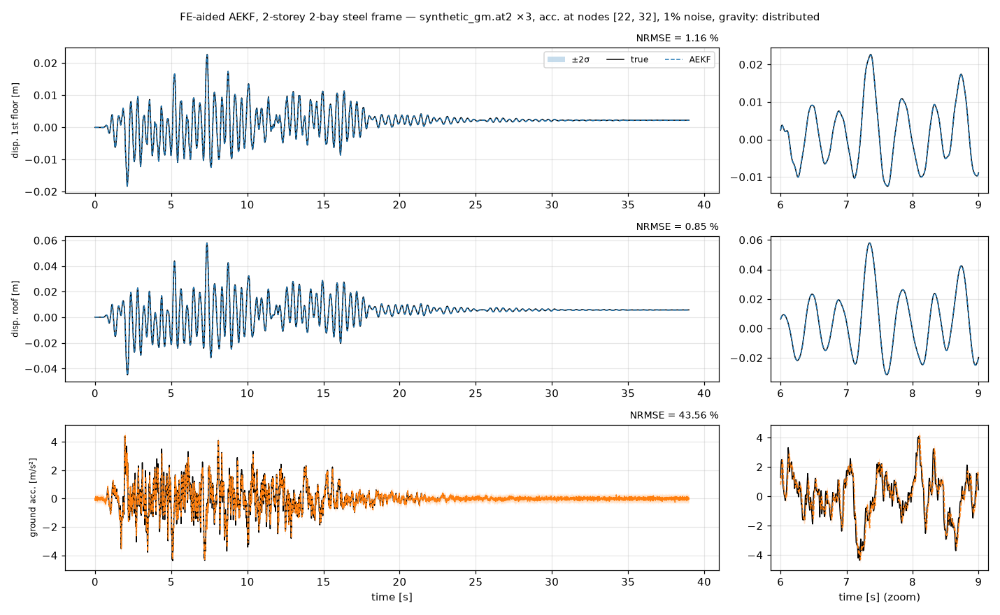
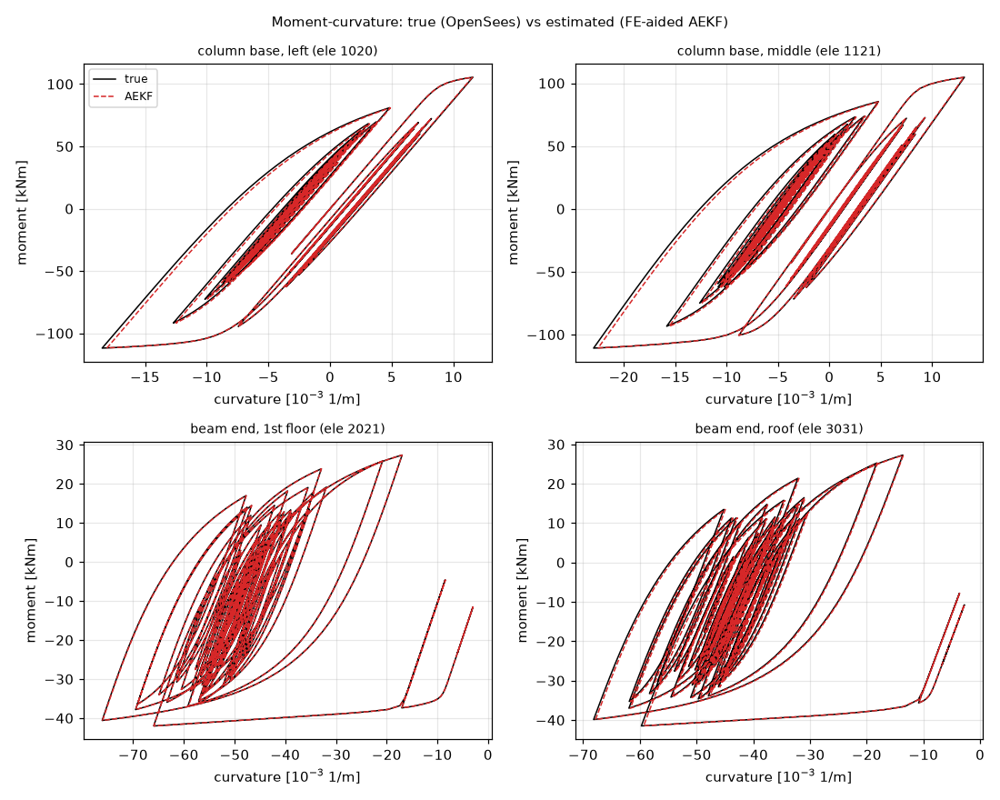
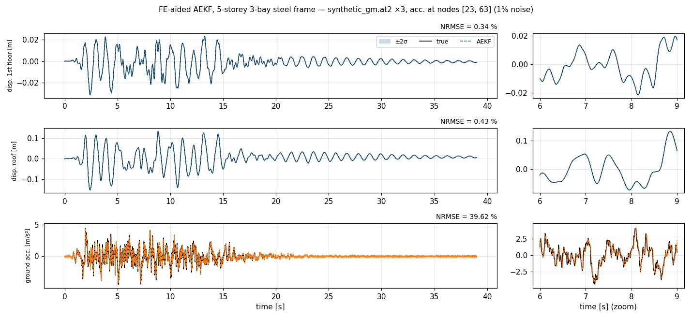
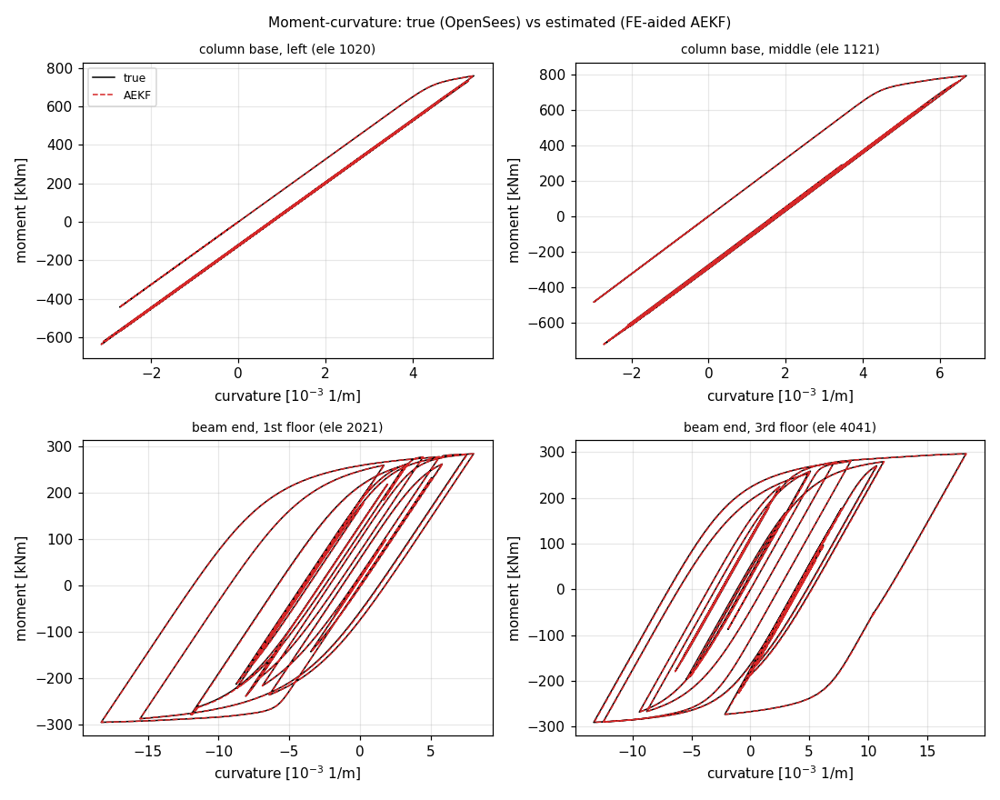
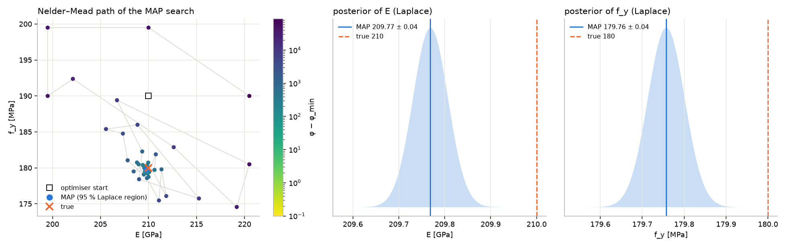
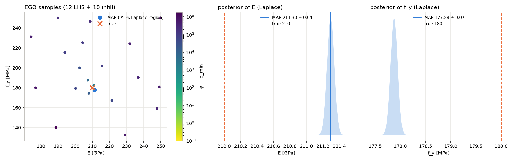

# FE-aided Kalman filter examples (OpenSeesPy)

Python examples of the **FE-aided Kalman filter**: an Augmented Extended Kalman Filter (AEKF) for joint input–state estimation of nonlinear structures. It is coupled non-intrusively with an [OpenSeesPy](https://openseespydoc.readthedocs.io) finite element (FE) model. The repository also includes **Bayesian model updating** of the FE model parameters, as in [2].

At every time step:
1. The AEKF predicts and updates the state (displacements, velocities) and the unknown input.
2. The OpenSees model is moved to the estimated displacements with one static step.
3. The model returns the tangent stiffness and the restoring forces. These drive the next prediction, so the nonlinear (hysteretic) behaviour is computed by the FE model itself.

The method and the notation follow [1] and [2]. Equation numbers from [2] are given in the code comments. Further background is in the PhD thesis [3].

Author: Luigi Caglio (lucag@dtu.dk), Technical University of Denmark.

## Examples

| Script | Structure | Measurements | What it does |
|---|---|---|---|
| `main_FEaidedKF.py` | 2-storey 2-bay frame (18 DOFs) | 2 accelerometers | FE-aided AEKF, written out step by step |
| `main_FEaidedKF_strainMeas_5storey.py` | 5-storey 3-bay frame of [1, 2] (60 DOFs) | 2 accelerometers + 1 strain gauge | FE-aided AEKF with strain measurements (Appendix B of [2]) |
| `main_FEaidedKF_BayesianUpdating.py` | 2-storey 2-bay frame | 2 accelerometers | Bayesian updating of E and f_y: MAP by Nelder–Mead, Laplace approximation |
| `main_FEaidedKF_BayesianUpdating_SMT.py` | 2-storey 2-bay frame | 2 accelerometers | Same, with Bayesian optimisation (EGO, [SMT](https://smt.readthedocs.io)) as in [2] |

In all examples:
- **Ground motion:** a synthetic ground acceleration scaled ×3 is the unknown input, modelled as a random walk.
- **Measurements:** the "true" response is computed with the same OpenSees model, and noise is added to it.
- **Model plot:** each script first plots the structure with [opsvis](https://github.com/sewkokot/opsvis), marking the sensors.

Supporting modules:

| File | Content |
|---|---|
| `frame_2storey_2bay_2D.py` | 2-storey 2-bay steel frame: force-based fibre elements, Steel02, lumped masses, nodal or distributed gravity |
| `frame_5storey_3bay_2D.py` | 5-storey 3-bay steel frame used in [1, 2]: IPE beams, HEB columns, masses from self-weight and floor loads, nodal gravity |
| `ops_helpers.py` | OpenSeesPy helpers: `.at2` reader, I-section fibres, M/C/K matrices, Rayleigh damping, transient analysis, FE-aided tangent update, section response, strain-gauge rows **H**ˢ, model plot |
| `fe_aided_kf.py` | The steps of `main_FEaidedKF.py` as functions (true response, measurements, AEKF with negative log-likelihood), used by the Bayesian updating scripts |
| `bayesian_updating.py` | Negative log-posterior, MAP (Nelder–Mead or EGO), finite-difference Hessian, Laplace approximation |
| `synthetic_gm.at2` | The synthetic ground motion |

## Installation and use

```bash
pip install -r requirements.txt
python main_FEaidedKF.py                          # ~10 s
python main_FEaidedKF_strainMeas_5storey.py       # ~1 min
python main_FEaidedKF_BayesianUpdating.py         # ~3 min (about 70 AEKF runs)
python main_FEaidedKF_BayesianUpdating_SMT.py     # ~1 min (22 AEKF runs)
```

Figures are written to `figures/`. `smt` is only needed for the SMT script.

The code was tested with Python 3.12.10, OpenSeesPy 3.8.0.0, NumPy 2.5.5, SciPy 1.18.1, Matplotlib 3.11.2, tqdm 4.70.1, opsvis 1.3.8 and SMT 2.15.1. OpenSeesPy supports only some Python versions on Windows; check its documentation if the import fails.

### Main settings (at the top of each script)

- `SENSOR_NODES`, `NOISE`: accelerometer locations and noise level (noise std / signal std).
- `STRAIN_GAUGES`, `NOISE_STRAIN` (strain example): `(element, integration point, "bottom" | "top")` per gauge.
- `S_LOAD`: random-walk covariance **S** of the unknown input. `Q_STATE`: process noise on the state.
- `K_UPDATE_TOL`: the filter matrices are rebuilt only when the tangent stiffness has changed by more than this, measured as max |ΔK_ii / K_ii| (Sec. 3.2 of [2]). The OpenSees model itself is updated at every step.
- `GRAVITY`:
  - 2-storey frame: `"distributed"` (uniform beam load, `eleLoad -beamUniform`), `"nodal"` (m·g at the floor nodes) or `None`;
  - 5-storey frame: `"nodal"`.

  Gravity is applied in a static analysis before the earthquake and is a known load **V** in the filter (eq. 19 of [2]). **V** appears explicitly in the filter equations: the point loads, or the equivalent nodal loads wL/2 and wL²/12 of a beam load. It is also included *implicitly* in the OpenSees model, because the gravity pattern stays applied throughout. The FE-aided update therefore applies only **P_R** − **V** as extra nodal loads.
- `MK_SECTIONS`: sections shown in the moment–curvature figure.
- Bayesian updating: `THETA_TRUE`, `BOUNDS` (uniform prior), and `N_DOE`, `N_ITER` (SMT).

## Ground motion

The examples use `synthetic_gm.at2`, an artificial ground acceleration (PGA 0.15 g) generated as filtered white noise with a time envelope, so the repository contains no third-party data. To use a recorded ground motion instead, download it from the [PEER NGA-West2 database](https://ngawest2.berkeley.edu/) and set `RECORD = "<file>.at2"`; `read_at2` reads the PEER format. The paper [2] used the Imperial Valley 1979 record, so results with the synthetic motion differ from those in the paper.

## Results

**FE-aided AEKF, 2-storey frame** (`main_FEaidedKF.py`). Displacement NRMSE: 1.2 % at the 1st floor, 0.9 % at the roof. The input estimate lags the true ground acceleration by about 2 time steps, because absolute accelerations have no direct feedthrough of the input.




**With a strain gauge, 5-storey frame of [1, 2]** (`main_FEaidedKF_strainMeas_5storey.py`). Displacement NRMSE: 0.2 % (1st floor and roof); strain NRMSE: 0.3 %.




**Bayesian model updating** (true E = 210 GPa, f_y = 180 MPa):

| | Model runs | Time | MAP E [GPa] | MAP f_y [MPa] |
|---|---|---|---|---|
| Nelder–Mead | 68 | 3 min | 209.8 | 179.8 |
| SMT (12 LHS + 10 EGO) | 22 | 1 min | 211.3 | 177.9 |

The Laplace posterior is very narrow (CoV ≈ 0.02–0.04 %), so it does not cover the small remaining bias of the MAP. The cause is that the filter assumes an almost perfect model (`Q_STATE` ≈ 0). See [2] for a discussion of identifiability and model uncertainty.




## References

If you use this code, please cite:

1. L. Caglio, H. Stang, R. Brincker, E. Katsanos (2023). FE-aided Kalman Filter for nonlinear state estimation with unknown input. *Mechanical Systems and Signal Processing*, 200, 110513. https://doi.org/10.1016/j.ymssp.2023.110513
2. L. Caglio, H. Stang, E. Katsanos (2025). Bayesian model updating and nonlinear response estimation of structures subjected to unknown loads via FE-aided Kalman Filtering. *Mechanical Systems and Signal Processing*, 241, 113505. https://doi.org/10.1016/j.ymssp.2025.113505
3. L. Caglio (2024). *Kalman Filter-based nonlinear response estimation of structures subjected to unknown loads*. PhD thesis, Technical University of Denmark. https://doi.org/10.11581/DTU.00000361

```bibtex
@article{Caglio2023FEaidedKF,
  author  = {Caglio, Luigi and Stang, Henrik and Brincker, Rune and Katsanos, Evangelos},
  title   = {{FE}-aided {K}alman {F}ilter for nonlinear state estimation with unknown input},
  journal = {Mechanical Systems and Signal Processing},
  volume  = {200},
  pages   = {110513},
  year    = {2023},
  doi     = {10.1016/j.ymssp.2023.110513}
}

@article{Caglio2025BayesianFEaidedKF,
  author  = {Caglio, Luigi and Stang, Henrik and Katsanos, Evangelos},
  title   = {Bayesian model updating and nonlinear response estimation of structures subjected to unknown loads via {FE}-aided {K}alman Filtering},
  journal = {Mechanical Systems and Signal Processing},
  volume  = {241},
  pages   = {113505},
  year    = {2025},
  doi     = {10.1016/j.ymssp.2025.113505}
}

@phdthesis{Caglio2024PhD,
  author = {Caglio, Luigi},
  title  = {Kalman Filter-based nonlinear response estimation of structures subjected to unknown loads},
  school = {Technical University of Denmark},
  year   = {2024},
  doi    = {10.11581/DTU.00000361}
}
```

## License

MIT, see [LICENSE](LICENSE). The dependencies keep their own licences (e.g. opsvis is GPL-3.0, SMT is BSD-3-Clause); they are installed separately and not included in this repository.
